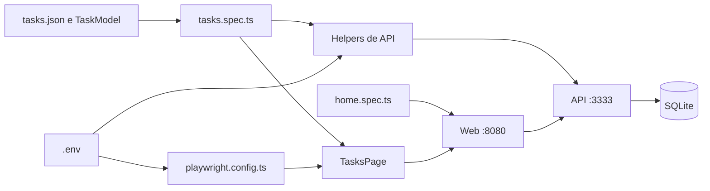
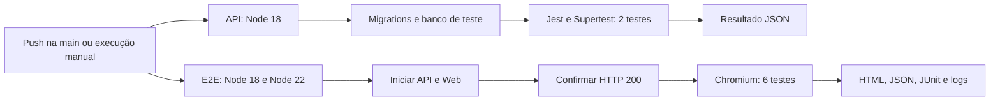

<div align="center">

# 🎭 QAx Playwright — Automação E2E, API e Integração Contínua

**Automação com Playwright e TypeScript desenvolvida por [Douglas Antonio](https://github.com/DouglasAntoni0).**

[](https://github.com/DouglasAntoni0/QAx-Playwright/actions/workflows/ci.yml)
[](https://playwright.dev/)
[](https://www.typescriptlang.org/)
[](https://nodejs.org/)
[](https://www.sqlite.org/)

</div>

## Sobre o projeto

Neste projeto, desenvolvo uma estratégia de automação que conecta **interface, API, persistência e integração contínua**. Meu trabalho vai da preparação dos dados à análise dos resultados: organizo os cenários, centralizo interações, verifico regras de negócio e automatizo a execução em um ambiente preparado pelo próprio pipeline.

A base é o curso **Playwright eXpress**, de Fernando Papito (QAx). A partir dele, venho evoluindo o projeto de estudo com **Page Object Model, helpers de API, fixtures tipadas, hooks, isolamento de banco e GitHub Actions**. A aplicação testada é o **Mark L**, um gerenciador de tarefas com interface React compilada, API Express e SQLite.

**Resultado verificado no GitHub Actions: 8 de 8 testes aprovados — 6 E2E no Chromium e 2 de integração da API.** [Consultar execução e artefatos](https://github.com/DouglasAntoni0/QAx-Playwright/actions/runs/41226988715).

## O que meu trabalho demonstra

| Competência aplicada | Evidência no projeto |
| --- | --- |
| **Arquitetura de automação** | A classe [`TasksPage`](playwright-mark/tests/support/pages/tasks/index.ts) concentra seletores, ações e asserções; os cenários permanecem focados no comportamento esperado. |
| **Estratégia híbrida de testes** | Os [`helpers de API`](playwright-mark/tests/support/helpers.ts) preparam os dados antes das ações pela interface, evitando usar a UI apenas para montar pré-condições. |
| **Verificação de regras de negócio** | Cadastro, duplicidade, campo obrigatório, conclusão e exclusão são verificados por resultados observáveis, como mensagem, persistência, estilo e presença na lista. |
| **Integração da API com persistência real** | Os testes com [`Jest e Supertest`](playwright-mark/apps/api/src/__tests__/Task.test.js) verificam HTTP 201, listagem do registro e rejeição de duplicidade com a mensagem correta, mantendo apenas uma tarefa persistida. |
| **Controle de estado e isolamento** | Hooks inicializam o Page Object; os testes da API aguardam a conexão, aplicam migrations e limpam os dados de um banco exclusivo de testes. |
| **Organização e tipagem** | [`tasks.json`](playwright-mark/tests/fixtures/tasks.json) separa massa e lógica; [`TaskModel`](playwright-mark/tests/fixtures/task.model.ts) define o contrato usado pela automação. |
| **Integração contínua de ponta a ponta** | O [`workflow`](.github/workflows/ci.yml) instala dependências, prepara banco, inicia API e Web, verifica HTTP 200 e executa as duas suítes em jobs independentes. |
| **Diagnóstico com evidências** | Relatórios HTML, JSON e JUnit, logs dos serviços e trace na primeira repetição ajudam a investigar falhas do CI. |
| **Gestão de ambiente** | Separei Node 18 na API e Node 22 no runner/Web e corrigi o carregamento do `.env` para funcionar tanto no editor quanto no terminal. |

Eu trato a automação como código que precisa ser entendido, executado e investigado por outra pessoa. Por isso, mantenho responsabilidades separadas, preparo explicitamente as pré-condições e publico evidências da execução junto ao pipeline.

## Arquitetura da suíte



Os testes descrevem os cenários. O Page Object resolve as interações com a tela, e os helpers preparam os registros necessários pela API.

A inicialização da tela fica no início de [`tasks.spec.ts`](playwright-mark/tests/tasks.spec.ts):

```ts
let tasksPage: TasksPage

test.beforeEach(async ({ page }) => {
    tasksPage = new TasksPage(page)
})
```

Cada cenário com tarefa nomeada remove previamente o registro com aquele nome. Os cenários de duplicidade, conclusão e exclusão também cadastram a tarefa pela API antes da ação na interface. Não há limpeza geral depois dos testes: os cenários podem deixar suas tarefas no banco local.

## Cenários automatizados

| Camada | Arquivo | Cenário | Verificação principal |
| --- | --- | --- | --- |
| E2E | [`home.spec.ts`](playwright-mark/tests/home.spec.ts) | Aplicação online | Título `Gerencie suas tarefas com Mark L`. |
| E2E | [`tasks.spec.ts`](playwright-mark/tests/tasks.spec.ts) | Cadastro de tarefa | Nova tarefa visível na lista. |
| E2E | `tasks.spec.ts` | Bloqueio de duplicidade | Modal com a mensagem `Task already exists!`. |
| E2E | `tasks.spec.ts` | Campo obrigatório | Propriedade HTML `validationMessage` igual a `This is a required field`. |
| E2E | `tasks.spec.ts` | Conclusão de tarefa | Estilo `text-decoration-line: line-through`. |
| E2E | `tasks.spec.ts` | Exclusão de tarefa | Tarefa ausente da lista visível. |
| API | [`Task.test.js`](playwright-mark/apps/api/src/__tests__/Task.test.js) | Cadastro com o contrato atual | HTTP 201 e tarefa encontrada na listagem com `is_done: false`. |
| API | `Task.test.js` | Bloqueio de nome duplicado | Cadastro inicial válido, HTTP 400 na repetição, mensagem de duplicidade e um único registro persistido. |

O projeto habilitado no [`playwright.config.ts`](playwright-mark/playwright.config.ts) é `chromium`, com o dispositivo `Desktop Chrome`. A configuração permite paralelismo; localmente não há retries. Quando `CI` está definido, são usados um worker, dois retries e bloqueio de `test.only`.

## Integração contínua no GitHub Actions

O [`ci.yml`](.github/workflows/ci.yml) roda a cada push na **`main`** e também permite execução manual pela aba Actions. O pipeline usa Ubuntu 24.04 e dois jobs independentes:



### Decisões que tornam o pipeline verificável

- **Instalação pelos lockfiles:** cada pacote usa `npm ci`, com cache de download do npm.
- **Runtime por responsabilidade:** Node 18.20.8 na API, compatível com `better-sqlite3`, e Node 22.23.3 na Web e no Playwright.
- **Banco isolado:** os dois jobs usam `database.test.sqlite`. Os testes de API limpam os registros antes de cada caso e removem o schema ao terminar; o E2E inicializa seu próprio banco com as migrations da aplicação.
- **Prontidão antes da execução:** o script [`wait-for-services.cjs`](playwright-mark/scripts/wait-for-services.cjs) exige HTTP 200 da listagem e da Web antes dos testes de interface.
- **Asserções que distinguem a causa da falha:** a duplicidade na API exige um primeiro cadastro aprovado e a mensagem `Task already exists!`, evitando aceitar um HTTP 400 causado por payload inválido.
- **Actions fixadas por SHA:** o workflow referencia revisões específicas das Actions e usa permissão de leitura do repositório.
- **Evidências em caso de falha:** os passos de upload são executados mesmo quando um teste falha, desde que o run não tenha sido cancelado.

### Relatórios disponíveis

Na página de cada execução, a seção **Artifacts** contém arquivos com retenção de **14 dias**:

| Artefato | Conteúdo |
| --- | --- |
| `api-results-<tentativa>` | Resultado JSON do Jest, com contagem e resultado dos testes da API. |
| `e2e-results-<tentativa>` | Relatório HTML do Playwright, resultados JSON e JUnit, logs da API/Web e traces quando houver primeira repetição. |

O relatório HTML pode ser consultado após baixar e extrair o artefato, usando `npx playwright show-report` com o caminho da pasta `playwright-report` extraída.

## Estrutura do repositório

```text
QAx-Playwright/
├── .github/workflows/ci.yml
├── README.md
├── Insomnia_markL.json
└── playwright-mark/
    ├── apps/
    │   ├── api/
    │   │   ├── jest.config.cjs
    │   │   ├── jest.setup.cjs
    │   │   ├── ormconfig.json
    │   │   ├── scripts/init-test-db.cjs
    │   │   └── src/
    │   │       ├── __tests__/             # Integração com Jest e Supertest
    │   │       ├── controllers/
    │   │       ├── database/              # Conexão, migration e SQLite
    │   │       ├── errors/
    │   │       ├── models/
    │   │       ├── repositories/
    │   │       ├── app.js
    │   │       ├── routes.js
    │   │       └── server.js
    │   └── web/                          # Interface já compilada
    ├── scripts/wait-for-services.cjs
    ├── tests/
    │   ├── fixtures/
    │   │   ├── task.model.ts
    │   │   └── tasks.json
    │   ├── support/
    │   │   ├── pages/tasks/index.ts
    │   │   └── helpers.ts
    │   ├── home.spec.ts
    │   └── tasks.spec.ts
    ├── .env.example
    ├── .node-version
    ├── package.json
    ├── playwright.config.ts
    └── tsconfig.json
```

A pasta `apps/` contém a aplicação usada no curso. A interface é distribuída como HTML, CSS e JavaScript compilados; os arquivos React originais não estão neste repositório.

## Ambiente e dependências

| Componente | Versão usada na validação | Endereço |
| --- | --- | --- |
| Runner Playwright | Node.js **22.23.3**, Playwright **1.63.0** e dotenv **18.0.9** | `playwright-mark/` |
| Web | Node.js **22.23.3**, http-server **14.1.1** | `http://localhost:8080` |
| API | Node.js **18.20.8**, Express **4.17.1**, TypeORM **0.2.31** e Yup **0.32.9** | `http://localhost:3333/tasks` |
| Testes da API | Jest **29.7.0** e Supertest **7.1.4**, com Node.js **18.20.8** | `playwright-mark/apps/api/` |
| Banco | better-sqlite3 **8.2.0** | `playwright-mark/apps/api/src/database/database.sqlite` |

A [`.node-version`](playwright-mark/.node-version) define Node **22** para o runner. A API usa Node **18.20.8** neste ambiente por causa da compatibilidade do binário nativo `better-sqlite3`.

## Como executar

Os exemplos usam PowerShell, Git e `fnm`. Em cada terminal, inicialize a integração do gerenciador de versões, caso ela ainda não esteja no perfil do PowerShell:

```powershell
fnm env --shell powershell | Out-String | Invoke-Expression
```

Clone o projeto:

```powershell
git clone https://github.com/DouglasAntoni0/QAx-Playwright.git
cd QAx-Playwright
```

### 1. API — terminal 1

Partindo da raiz do repositório:

```powershell
cd playwright-mark/apps/api
fnm install 18.20.8
fnm use 18.20.8
node --version
npm ci
npm run db:init
npm run dev
```

`db:init` aplica as migrations pendentes; não apaga os dados existentes. O banco SQLite inicial está versionado. O `.env` da API define `NODE_ENV="development"`, habilitando as rotas auxiliares usadas pelos testes.

Valide a rota de listagem:

```powershell
Invoke-RestMethod http://localhost:3333/tasks
```

### 2. Web — terminal 2

Partindo novamente da raiz do repositório:

```powershell
cd playwright-mark/apps/web
fnm install 22.23.3
fnm use 22.23.3
npm ci
npm run dev
```

Abra [http://localhost:8080](http://localhost:8080). Tanto a API quanto a Web oferecem `npm run dev` e `npm start` em suas próprias pastas.

### 3. Testes — terminal 3

Partindo novamente da raiz do repositório:

```powershell
cd playwright-mark
fnm install 22.23.3
fnm use 22.23.3
npm ci
if (-not (Test-Path .env)) { Copy-Item .env.example .env }
npx playwright install chromium
npm test
```

O arquivo local `playwright-mark/.env` deve conter:

```dotenv
BASE_URL=http://localhost:8080
BASE_API=http://localhost:3333
```

Esse arquivo é ignorado pelo Git. A configuração resolve seu caminho a partir de `__dirname`:

```ts
import dotenv from 'dotenv';
import path from 'node:path';

dotenv.config({ path: path.resolve(__dirname, '.env') });
```

Isso permite executar a suíte dentro de `playwright-mark` ou pela raiz do repositório, como faz a extensão do editor. Pela raiz, use:

```powershell
node playwright-mark/node_modules/@playwright/test/cli.js test --config=playwright-mark/playwright.config.ts
```

Dentro de `playwright-mark`, os comandos disponíveis são:

```powershell
npm test                                # Suíte E2E completa
npm run test:ui                          # UI Mode
npx playwright test tests/tasks.spec.ts  # Apenas os cenários de tarefas
npx playwright show-report              # Relatório HTML da última execução
```

Os serviços devem estar ativos antes dos testes: não há inicialização automática por `webServer`. A pasta `playwright-report/` é gerada localmente e ignorada pelo Git.

No GitHub Actions, o próprio workflow inicia os serviços antes da suíte E2E.

`BASE_API` altera o endereço usado pelos helpers. A interface compilada contém seu próprio endereço `http://localhost:3333`; mudar o `.env` da suíte não reconfigura esse bundle.

### 4. Testes de integração da API

Partindo da raiz do repositório:

```powershell
cd playwright-mark/apps/api
fnm use 18.20.8
npm ci
npm test
```

O Supertest carrega a aplicação Express diretamente; não é necessário iniciar o servidor da porta 3333 para essa suíte. O setup do Jest define `NODE_ENV=test`, e a aplicação usa `src/database/database.test.sqlite`, ignorado pelo Git. Os testes aguardam `databaseReady` antes de aplicar as migrations e fazer as requisições.

O script `npm run db:init:test` prepara esse mesmo tipo de banco para o servidor usado no job E2E. A dependência transitiva `figlet` está fixada em 1.8.2 no pacote da API para manter a compatibilidade da ferramenta de linha de comando do TypeORM com Node 18.

## Resultados de execução

Validação no **GitHub Actions em 31/10/2026**, com ambos os jobs concluídos com sucesso:

| Suíte | Resultado | Falhas | Ignorados |
| --- | --- | --- | --- |
| Integração da API — Jest e Supertest | **2/2 aprovados** | 0 | 0 |
| E2E — Playwright e Chromium | **6/6 aprovados** | 0 | 0 |
| **Total** | **8/8 aprovados** | **0** | **0** |

**Evidência:** [execução 41226988715](https://github.com/DouglasAntoni0/QAx-Playwright/actions/runs/41226988715), commit [`bfd981d`](https://github.com/DouglasAntoni0/QAx-Playwright/commit/bfd981dec5ff1706b10597147ec4ca1b5c457443). As contagens foram conferidas nos arquivos JSON publicados como artefatos. Nessa execução, o Playwright registrou também **zero casos flaky**; esse dado descreve o run verificado, não uma garantia para execuções futuras.

## Rotas da API

| Método | Rota | Comportamento |
| --- | --- | --- |
| `GET` | `/tasks` | Lista as tarefas por data de criação. |
| `POST` | `/tasks` | Cadastra uma tarefa com `name` e `is_done: false`. |
| `PUT` | `/tasks/:id` | Atualiza `is_done` de uma tarefa existente. |
| `DELETE` | `/tasks/:id` | Exclui uma tarefa pelo identificador. |
| `DELETE` | `/helper/tasks` | Exclui pelo `name` enviado no corpo JSON. |
| `DELETE` | `/helper/tasks/:task_name` | Exclui pelo nome informado na URL. |

O cadastro rejeita nomes duplicados e tarefas inicialmente concluídas. As rotas `/helper/*` são registradas quando `NODE_ENV !== 'production'`.

A coleção [`Insomnia_markL.json`](Insomnia_markL.json) contém chamadas de cadastro, listagem, atualização e exclusão. Ela não contém as rotas auxiliares. Os IDs dos exemplos precisam ser ajustados aos registros locais; o POST incluído usa `is_done: true`, que o contrato atual rejeita. Para um cadastro válido, use `false`.

## Diagnóstico de ambiente

| Sintoma | Causa e verificação |
| --- | --- |
| `apiRequestContext.delete: Invalid URL` no editor | Confirme a existência de `playwright-mark/.env`. A configuração usa caminho absoluto para carregar o arquivo mesmo com a execução iniciada pela raiz. |
| `ECONNREFUSED` ou lista de tarefas indisponível | Verifique primeiro `GET http://localhost:3333/tasks` e mantenha a API ativa. |
| `ERR_DLOPEN_FAILED` ao iniciar a API | Confirme Node 18.20.8 no terminal da API e a compatibilidade da instalação de `better-sqlite3`. |
| `Cannot GET /` na porta 3333 | A API não possui rota raiz; a listagem fica em `/tasks`. |

## Escopo atual e evolução

- O `npm test` em `playwright-mark` executa os seis E2E no Chromium; em `apps/api`, executa os dois testes de integração. O CI executa ambos os comandos em seus respectivos pacotes.
- Firefox e WebKit aparecem como exemplos comentados na configuração e ainda não integram o pipeline.
- Faker está instalado como dependência de desenvolvimento, mas os cenários atuais usam os dados estáticos de `tasks.json`.
- O [`tsconfig.json`](playwright-mark/tsconfig.json) habilita `strict: true`, `resolveJsonModule` e `noEmit`; ainda não há um script dedicado de verificação estática de tipos.

## Próximos estudos

- [x] Page Object Model e helpers de API.
- [x] Massa em JSON e contrato `TaskModel`.
- [x] Cadastro, duplicidade, campo obrigatório, conclusão e exclusão.
- [x] Inicialização de `TasksPage` no `beforeEach`.
- [x] Carregamento do `.env` independente da pasta de execução.
- [ ] Geração de massa dinâmica com Faker.
- [ ] Evolução dos seletores da interface.
- [x] Atualização do contrato e das asserções dos testes de API, com Jest e Supertest declarados.
- [x] Pipeline com testes de API e E2E no GitHub Actions.
- [x] Relatórios e logs publicados como artefatos do CI.
- [ ] Execução em Firefox e WebKit.
- [ ] Verificação estática de tipos no pipeline.

## Autor e referência

**Douglas Antonio** — [GitHub](https://github.com/DouglasAntoni0).

Curso de referência: [Playwright eXpress](https://www.udemy.com/course/playwright-express/), de **Fernando Papito (QAx)**. A automação, as refatorações de suporte e a documentação deste repositório acompanham minha evolução prática nos estudos.
