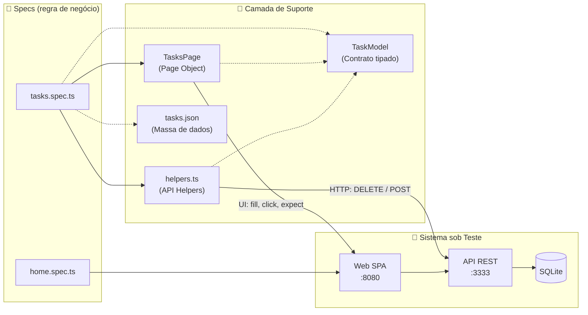

<div align="center">

# 🎭 QAx Playwright — Automação de Testes E2E com Arquitetura Profissional

**Suíte de testes End-to-End (UI + API) em Playwright e TypeScript, projetada e evoluída por [Douglas Antonio](https://github.com/DouglasAntoni0).**

*Testes rápidos, isolados, legíveis e prontos para escalar, do jeito que times de engenharia de verdade trabalham.*

[](https://playwright.dev/)
[](https://www.typescriptlang.org/)
[](https://nodejs.org/)
[](https://expressjs.com/)
[](https://www.sqlite.org/)

[](#-resultados-de-execução)
[](#-resultados-de-execução)
[](#-resultados-de-execução)
[](#-arquitetura-da-suíte)

</div>

---

## 📌 Resumo em 30 segundos

> **Quem sou:** Douglas Antonio, QA Automation Engineer focado em Playwright, TypeScript e testes E2E & API.
>
> **O que este repositório prova:** que eu sei **estruturar uma suíte de automação do zero**, aplicando os mesmos padrões usados em projetos profissionais: **Page Object Model**, **tipagem estrita**, **massa de dados externa em JSON**, **preparação de estado via API**, **testes 100% independentes** e **execução paralela sem flakiness**.

| 📊 Indicador | Resultado |
| --- | --- |
| Cenários automatizados | **5** (smoke, cadastro, regra de negócio, validação de formulário e conclusão de tarefa) |
| Tempo total da suíte | **~1.8s** com **5 workers em paralelo** |
| Taxa de flakiness | **0%** em execuções consecutivas |
| Dependência entre testes | **Nenhuma**: cada teste prepara e limpa a própria massa |
| Camadas de abstração | **Page Objects** (UI) + **Helpers de API** + **Models tipados** + **Massa de dados em JSON** |

---

## 🎯 Visão Geral

Este repositório reúne meu trabalho prático em **Engenharia de Qualidade de Software e Automação de Testes E2E**, desenvolvido a partir do curso **[Playwright eXpress](https://www.udemy.com/course/playwright-express/)** (QAx / Fernando Papito).

Eu não me limitei a reproduzir exercícios. A cada aula, **refatorei, documentei e elevei o padrão do código**, tratando o projeto como uma suíte real de produção sobre a aplicação full-stack **Mark L**: um gerenciador de tarefas com SPA Web, API REST em Express/TypeORM e banco SQLite.

> 💡 **Evolução contínua:** cada commit representa um passo técnico consciente, saindo de testes procedurais para uma arquitetura em camadas com **Design Patterns**, **DRY** e **automação híbrida (API + UI)**.

---

## 🏆 Competências que Eu Demonstro Neste Projeto

| Competência | Como eu apliquei na prática |
| --- | --- |
| 🧱 **Page Object Model (POM)** | Encapsulei seletores e ações da tela de tarefas na classe [`TasksPage`](playwright-mark/tests/support/pages/tasks/index.ts). Se a UI mudar, a correção acontece **em um único lugar**, e os testes continuam intactos. |
| ⚡ **Estratégia Híbrida (API + UI)** | Uso o `APIRequestContext` do Playwright para **limpar e pré-cadastrar dados direto na API REST**, evitando passos lentos e frágeis pela interface só para montar cenário. |
| 🧼 **Clean Code & DRY** | Chamadas HTTP repetidas foram extraídas para [`helpers.ts`](playwright-mark/tests/support/helpers.ts). Os arquivos `.spec.ts` ficaram enxutos e focados **apenas na regra de negócio**. |
| 🔒 **Tipagem Estrita em TypeScript** | Contratos de dados com [`TaskModel`](playwright-mark/tests/fixtures/task.model.ts) e `strict: true`, garantindo *autocomplete* seguro e erros detectados **antes** da execução. |
| 📦 **Massa de Dados Desacoplada** | Os dados de cada cenário ficam em [`tasks.json`](playwright-mark/tests/fixtures/tasks.json), importado com `resolveJsonModule` e tipado como `TaskModel`. Alterar a massa **não exige mexer no código do teste**. |
| 🗂️ **Organização por Funcionalidade** | Cenários agrupados com `test.describe` (`cadastro` e `atualização`), deixando o relatório e a leitura da suíte mais claros. |
| 🔁 **Independência e Idempotência** | Cada cenário controla a própria massa (`deleteTaskByHelper` + `postTask`). Resultado: **execução 100% paralela**, sem efeito colateral e sem "sujeira" no banco. |
| ✅ **Cobertura além do Happy Path** | Valido o fluxo feliz, a **regra de negócio de duplicidade** (modal SweetAlert2), a **validação nativa de formulário HTML5** (`validationMessage`) e a **conclusão de tarefa**, conferindo o estilo `line-through` via `toHaveCSS()`. |
| 🛠️ **Troubleshooting de Ambiente** | Diagnostiquei e resolvi a falha `ERR_DLOPEN_FAILED` do módulo nativo `better-sqlite3` isolando versões do Node.js por camada (`18.20.8` na API e `22.23.3` no runner). |
| 🔍 **Observabilidade** | **HTML Reporter**, **UI Mode** e **Trace Viewer** (`on-first-retry`) configurados para inspeção de rede, DOM, *snapshots* e console. |

---

## 🧭 Arquitetura da Suíte



**Princípio central:** os testes descrevem **o quê** está sendo validado; os Page Objects e Helpers resolvem **como** interagir com a UI e com a API.

---

## ✨ Destaques do Código

### 1. Page Object Model: [`tests/support/pages/tasks/index.ts`](playwright-mark/tests/support/pages/tasks/index.ts)

Toda a interação com a tela de tarefas fica centralizada em uma classe com locators `readonly` e métodos de ação e asserção com nomes expressivos:

```ts
export class TasksPage {
    readonly page: Page
    readonly inputTaskName: Locator

    constructor(page: Page) {
        this.page = page
        this.inputTaskName = page.locator('input[class*=InputNewTask]')
    }

    async go() {
        await this.page.goto('http://localhost:8080')
    }

    async create(task: TaskModel) {
        await this.inputTaskName.fill(task.name)
        await this.page.click('css=button >> text=Create')
    }

    async toggle(taskName: string) {
        const target = this.page.locator(`xpath=//p[text()="${taskName}"]/..//button[contains(@class, "Toggle")]`)
        await target.click()
    }

    async shouldHaveText(taskName: string) {
        const target = this.page.locator(`css=.task-item p >> text=${taskName}`)
        await expect(target).toBeVisible()
    }

    async alertHaveText(text: string) {
        const target = this.page.locator('.swal2-html-container')
        await expect(target).toHaveText(text)
    }

    async shouldBeDone(taskName: string) {
        const target = this.page.getByText(taskName)
        await expect(target).toHaveCSS('text-decoration-line', 'line-through')
    }
}
```

### 2. Helpers de API Reutilizáveis: [`tests/support/helpers.ts`](playwright-mark/tests/support/helpers.ts)

Preparação e limpeza de estado via HTTP, com validação do status da resposta antes de seguir com o teste:

```ts
export async function deleteTaskByHelper(request: APIRequestContext, taskName: string) {
    const response = await request.delete(`http://localhost:3333/helper/tasks/${taskName}`)
    expect(response.ok()).toBeTruthy()
}

export async function postTask(request: APIRequestContext, task: TaskModel) {
    const newTask = await request.post('http://localhost:3333/tasks', { data: task })
    expect(newTask.ok()).toBeTruthy()
}
```

### 3. Massa de Dados em JSON: [`tests/fixtures/tasks.json`](playwright-mark/tests/fixtures/tasks.json)

Os dados ficam fora do código, com uma chave para cada cenário. O import funciona graças ao `resolveJsonModule: true` no [`tsconfig.json`](playwright-mark/tsconfig.json):

```json
{
    "success": { "name": "Ler um livro de TypeScript", "is_done": false },
    "duplicate": { "name": "Comprar Ketchup", "is_done": false },
    "required": { "name": "", "is_done": false },
    "update": { "name": "Pagar a fatura do cartão", "is_done": false }
}
```

### 4. Testes Limpos no Padrão AAA (*Arrange, Act, Assert*): [`tests/tasks.spec.ts`](playwright-mark/tests/tasks.spec.ts)

Com POM + Helpers + massa em JSON, cada teste fica curto, legível e quase uma especificação em linguagem natural:

```ts
import data from './fixtures/tasks.json'

test.describe('atualização', () => {
    test('deve concluir uma tarefa', async ({ page, request }) => {
        const task = data.update as TaskModel

        await deleteTaskByHelper(request, task.name)
        await postTask(request, task)

        const tasksPage: TasksPage = new TasksPage(page)

        await tasksPage.go()
        await tasksPage.toggle(task.name)
        await tasksPage.shouldBeDone(task.name)
    })
})
```

### 5. Validação de Formulário HTML5 via DOM

Mensagens nativas de validação não aparecem no DOM como texto. Por isso, leio a propriedade `validationMessage` diretamente do elemento com `evaluate()`:

```ts
const validationMessage = await tasksPage.inputTaskName.evaluate(
    e => (e as HTMLInputElement).validationMessage
)
expect(validationMessage).toEqual('This is a required field')
```

---

## 🧪 Cenários Implementados

| # | Arquivo | Cenário | Estratégia aplicada | Status |
| --- | --- | --- | --- | --- |
| 1 | [`home.spec.ts`](playwright-mark/tests/home.spec.ts) | `webapp deve estar online` | Smoke test de disponibilidade validando o `<title>` da aplicação | ✅ |
| 2 | [`tasks.spec.ts`](playwright-mark/tests/tasks.spec.ts) | `deve poder cadastrar uma nova tarefa` | Limpeza via API (`DELETE /helper/tasks/:name`) → cadastro via `TasksPage` → asserção de visibilidade na lista | ✅ |
| 3 | [`tasks.spec.ts`](playwright-mark/tests/tasks.spec.ts) | `não deve permitir tarefa duplicada` | Limpeza + *seed* via API (`POST /tasks`) → recadastro via UI → asserção do modal SweetAlert2 (`Task already exists!`) | ✅ |
| 4 | [`tasks.spec.ts`](playwright-mark/tests/tasks.spec.ts) | `deve validar o campo obrigatório` | Submissão com nome vazio → leitura da `validationMessage` nativa do input via `evaluate()` | ✅ |
| 5 | [`tasks.spec.ts`](playwright-mark/tests/tasks.spec.ts) | `deve concluir uma tarefa` | Limpeza + *seed* via API → clique no botão *Toggle* (localizado por XPath) → asserção do estilo `line-through` com `toHaveCSS()` | ✅ |

### 📈 Resultados de Execução

Em **19/10/2026**, a suíte completa foi executada no Chromium:

```text
Running 5 tests using 5 workers

  ok 1 [chromium] › tests\home.spec.ts:3:5 › webapp deve estar online (586ms)
  ok 2 [chromium] › tests\tasks.spec.ts:10:9 › cadastro › deve poder cadastrar uma nova tarefa (694ms)
  ok 3 [chromium] › tests\tasks.spec.ts:51:9 › atualização › deve concluir uma tarefa (711ms)
  ok 5 [chromium] › tests\tasks.spec.ts:35:9 › cadastro › deve validar o campo obrigatório (729ms)
  ok 4 [chromium] › tests\tasks.spec.ts:22:9 › cadastro › não deve permitir tarefa duplicada (828ms)

  5 passed (1.8s)
```

- **5 de 5 cenários aprovados** em **1.8s**, com **zero falhas** e **zero flakiness**.
- Execuções consecutivas confirmam que os helpers de API mantêm o banco sempre no estado esperado.
- Ambiente validado com **Node.js 22.23.3** (runner + web) e **Node.js 18.20.8** (API + SQLite).

---

## 🛠️ Stack Tecnológica

| Camada | Tecnologias | Endereço local |
| --- | --- | --- |
| **Suíte de Automação** | Playwright Test `^1.63.0`, TypeScript (`strict: true`), Faker `^10.6.0` | `playwright-mark/` |
| **Front-end (SUT)** | SPA React compilada, servida via `http-server` | `http://localhost:8080` |
| **API REST (SUT)** | Node.js, Express `4.17`, TypeORM, Yup, UUID | `http://localhost:3333/tasks` |
| **Banco de Dados** | SQLite 3 (`better-sqlite3` `8.2.0`) | `apps/api/src/database/` |

> ⚠️ **Nota técnica (Troubleshooting):** o `better-sqlite3` usa *addons* nativos em C++. Em versões recentes do Node.js, a API falhava com `ERR_DLOPEN_FAILED`. Resolvi isolando a API no **Node.js 18.20.8** (via `fnm`), enquanto a suíte Playwright e o servidor web rodam no **Node.js 22.23.3** (definido em [`.node-version`](playwright-mark/.node-version)).

---

## 🗂️ Estrutura do Repositório

```text
QAx-Playwright/
├── README.md
├── Insomnia_markL.json                 # Coleção Insomnia para exploração manual da API
└── playwright-mark/
    ├── apps/
    │   ├── api/                        # API REST + TypeORM + SQLite (porta 3333)
    │   │   └── src/
    │   │       ├── controllers/        # TaskController (CRUD + rotas /helper)
    │   │       ├── database/           # Conexão, migrations e arquivo SQLite
    │   │       ├── errors/             # Tratamento padronizado de erros (AppError)
    │   │       ├── models/             # Entidade Task
    │   │       ├── repositories/       # TasksRepository
    │   │       ├── routes.js           # Definição das rotas
    │   │       └── server.js           # Inicialização do servidor
    │   └── web/                        # Front-end SPA do Mark L (porta 8080)
    ├── tests/                          # 🎭 Suíte E2E (Playwright + TypeScript)
    │   ├── fixtures/
    │   │   ├── task.model.ts           # Contrato tipado TaskModel
    │   │   └── tasks.json              # Massa de dados dos cenários
    │   ├── support/
    │   │   ├── pages/
    │   │   │   └── tasks/
    │   │   │       └── index.ts        # Page Object TasksPage
    │   │   └── helpers.ts              # Helpers de API (deleteTaskByHelper, postTask)
    │   ├── home.spec.ts                # Smoke test da página inicial
    │   └── tasks.spec.ts               # Cenários de cadastro e atualização de tarefas
    ├── .node-version                   # Versão do Node.js do runner (22)
    ├── package.json
    ├── playwright.config.ts            # Paralelismo, retries, reporter e trace
    └── tsconfig.json                   # TypeScript com strict: true e resolveJsonModule
```

---

## 🌐 Rotas da API (Mark L)

| Método | Rota | Função |
| --- | --- | --- |
| `GET` | `/tasks` | Lista todas as tarefas |
| `POST` | `/tasks` | Cadastra uma tarefa (`{ name, is_done }`) |
| `PUT` | `/tasks/:id` | Atualiza o status `is_done` |
| `DELETE` | `/tasks/:id` | Remove uma tarefa pelo UUID |
| `DELETE` | `/helper/tasks` | 🧪 *Helper de teste:* remove tarefa pelo nome (corpo JSON) |
| `DELETE` | `/helper/tasks/:task_name` | 🧪 *Helper de teste:* remove tarefa pelo nome (URL) |

As rotas `/helper/*` só ficam ativas quando `NODE_ENV !== 'production'`, permitindo resetar o estado do banco antes de cada cenário. A coleção [`Insomnia_markL.json`](Insomnia_markL.json) documenta todas essas chamadas.

---

## 🚀 Como Executar Localmente

Os comandos abaixo usam **PowerShell** e o gerenciador de versões **`fnm`** (também funciona com `nvm`).

### 1. Clonar o repositório

```powershell
git clone https://github.com/DouglasAntoni0/QAx-Playwright.git
cd QAx-Playwright
```

### 2. Subir a API (Terminal 1)

```powershell
cd playwright-mark/apps/api
fnm install 18.20.8
fnm use 18.20.8
npm ci
npm run dev
```

> A API ficará ativa em `http://localhost:3333/tasks`. Para um banco limpo, rode `npm run db:init` antes do `npm run dev`.

### 3. Subir a Interface Web (Terminal 2)

```powershell
cd playwright-mark/apps/web
fnm install 22.23.3
fnm use 22.23.3
npm ci
npm run dev
```

> A aplicação ficará disponível em `http://localhost:8080`.

### 4. Executar a Suíte de Testes (Terminal 3)

```powershell
cd playwright-mark
fnm use 22.23.3
npm ci
npx playwright install chromium
npm test
```

Comandos úteis:

```powershell
npm run test:ui                           # UI Mode interativo do Playwright
npx playwright test tests/tasks.spec.ts   # Executa apenas a suíte de tarefas
npx playwright show-report                # Abre o relatório HTML
```

---

## 🗺️ Roadmap de Evolução

- [x] Estruturar o projeto com Playwright e TypeScript (`strict: true`)
- [x] Configurar e validar o ambiente completo (Web + API + SQLite)
- [x] Smoke test da página inicial (`home.spec.ts`)
- [x] Teste E2E de cadastro de nova tarefa
- [x] Modelagem tipada (`TaskModel`) em `tests/fixtures/`
- [x] Helpers reutilizáveis de API (`deleteTaskByHelper` e `postTask`)
- [x] Bloqueio de tarefa duplicada validando modal SweetAlert2
- [x] Arquitetura **Page Object Model** com a classe `TasksPage`
- [x] Validação de campo obrigatório via `validationMessage` (HTML5)
- [x] Agrupar cenários por funcionalidade com `test.describe`
- [x] Massa de testes em *fixtures* JSON (`tasks.json`)
- [x] Automatizar a conclusão (toggle) de tarefas pela interface
- [ ] Automatizar a exclusão de tarefas pela interface
- [ ] Usar hooks (`beforeEach`) para reduzir repetição entre cenários
- [ ] Geração dinâmica de massa com Faker
- [ ] Centralizar URLs com `baseURL` e variáveis de ambiente (`.env`)
- [ ] Execução multi-browser (Chromium, Firefox, WebKit) e pipeline no **GitHub Actions**

---

## 👨‍💻 Sobre o Autor

<table>
  <tr>
    <td align="center" width="140">
      <a href="https://github.com/DouglasAntoni0">
        <br>
        <sub><b>Douglas Antonio</b></sub>
      </a>
    </td>
    <td>
      <b>QA Automation Engineer | Playwright · TypeScript · Testes E2E & API</b><br><br>
      Sou apaixonado por <b>Qualidade de Software</b> e acredito que testar vai muito além de verificar se um botão funciona: é construir <b>confiança, velocidade de entrega e prevenção de regressões</b> com código limpo e bem arquitetado.<br><br>
      Neste repositório eu demonstro, na prática, que sei <b>estruturar automação do zero</b>, aplicar <b>Page Object Model</b>, combinar <b>API e UI</b> para testes mais rápidos e estáveis, manter <b>tipagem estrita</b> em TypeScript e <b>diagnosticar problemas reais de ambiente</b>.<br><br>
      📫 <b>Contato:</b> <a href="mailto:douglas.doug1235@gmail.com">douglas.doug1235@gmail.com</a> ·
      🐙 <b>GitHub:</b> <a href="https://github.com/DouglasAntoni0">github.com/DouglasAntoni0</a>
    </td>
  </tr>
</table>

---

<div align="center">

**Referência de estudo:** curso [Playwright eXpress](https://www.udemy.com/course/playwright-express/), de Fernando Papito (QAx).<br>
*Suíte de testes, refatorações, arquitetura de suporte e documentação desenvolvidas por **Douglas Antonio**.*

</div>
