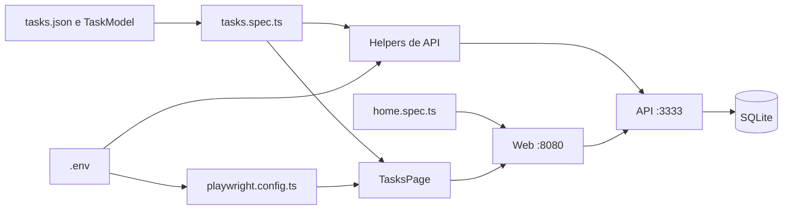

<div align="center">

# 🎭 QAx Playwright — Testes E2E do Mark L

**Automação com Playwright e TypeScript desenvolvida por [Douglas Antonio](https://github.com/DouglasAntoni0).**

[](https://playwright.dev/)
[](https://www.typescriptlang.org/)
[](https://nodejs.org/)
[](https://www.sqlite.org/)

</div>

## Sobre o projeto

Este é meu projeto de estudo do curso **Playwright eXpress**, de Fernando Papito (QAx), com refatorações e documentação que evoluem conforme avanço nos estudos.

A aplicação usada nos testes é o **Mark L**, um gerenciador de tarefas com interface React compilada, API Express e banco SQLite. Meu trabalho de automação combina ações pela interface com preparação de dados via API, usando Page Object Model, massa em JSON e um contrato tipado para as tarefas.

A suíte atual tem **seis cenários E2E no Chromium**. Os testes JavaScript legados incluídos na API são separados dessa suíte; sua situação está descrita em [Limites atuais](#limites-atuais).

## Práticas aplicadas

| Prática | Implementação no projeto |
| --- | --- |
| Page Object Model | A classe [`TasksPage`](playwright-mark/tests/support/pages/tasks/index.ts) concentra os seletores, as ações e as asserções da tela de tarefas. |
| Preparação via API | Os [`helpers`](playwright-mark/tests/support/helpers.ts) removem e cadastram tarefas por HTTP, verificando o sucesso da resposta antes de seguir para a UI. |
| Inicialização compartilhada | O `test.beforeEach` instancia `TasksPage` com a página de cada teste, eliminando a repetição dos construtores nos cenários. |
| Massa externa e tipagem | [`tasks.json`](playwright-mark/tests/fixtures/tasks.json) contém os dados dos cenários; [`TaskModel`](playwright-mark/tests/fixtures/task.model.ts) define `name` e `is_done`. |
| Configuração por ambiente | `BASE_URL` configura a navegação e `BASE_API` configura os helpers. O `.env` é localizado pela pasta do arquivo de configuração, inclusive ao executar pela raiz no editor. |
| Regras de negócio e formulário | Além do cadastro, os testes verificam duplicidade, campo obrigatório, conclusão e exclusão. |
| Diagnóstico | O projeto configura relatório HTML e trace na primeira repetição. A API usa Node 18 para manter a compatibilidade com o módulo nativo SQLite deste ambiente. |

O [`tsconfig.json`](playwright-mark/tsconfig.json) habilita `strict: true`, `resolveJsonModule` e `noEmit`. O comando `npm test` executa o Playwright; não há um script separado de verificação estática de tipos.

## Arquitetura da suíte



Os testes descrevem os cenários. O Page Object resolve as interações com a tela, e os helpers preparam os registros necessários pela API.

A inicialização da tela fica no início de [`tasks.spec.ts`](playwright-mark/tests/tasks.spec.ts):

```ts
let tasksPage: TasksPage

test.beforeEach(async ({ page }) => {
    tasksPage = new TasksPage(page)
})
```

Cada cenário com tarefa nomeada remove previamente o registro com aquele nome. Os cenários de duplicidade, conclusão e exclusão também cadastram a tarefa pela API antes da ação na interface. Não há limpeza geral depois dos testes: os cenários podem deixar suas tarefas no banco local.

## Cenários automatizados

| Arquivo | Cenário | Verificação principal |
| --- | --- | --- |
| [`home.spec.ts`](playwright-mark/tests/home.spec.ts) | Aplicação online | Título `Gerencie suas tarefas com Mark L`. |
| [`tasks.spec.ts`](playwright-mark/tests/tasks.spec.ts) | Cadastro de tarefa | Nova tarefa visível na lista. |
| `tasks.spec.ts` | Bloqueio de duplicidade | Modal com a mensagem `Task already exists!`. |
| `tasks.spec.ts` | Campo obrigatório | Propriedade HTML `validationMessage` igual a `This is a required field`. |
| `tasks.spec.ts` | Conclusão de tarefa | Estilo `text-decoration-line: line-through`. |
| `tasks.spec.ts` | Exclusão de tarefa | Tarefa ausente da lista visível. |

O projeto habilitado no [`playwright.config.ts`](playwright-mark/playwright.config.ts) é `chromium`, com o dispositivo `Desktop Chrome`. A configuração permite paralelismo; localmente não há retries. Quando `CI` está definido, são usados um worker, dois retries e bloqueio de `test.only`.

## Estrutura do repositório

```text
QAx-Playwright/
├── README.md
├── Insomnia_markL.json
└── playwright-mark/
    ├── apps/
    │   ├── api/
    │   │   ├── ormconfig.json
    │   │   └── src/
    │   │       ├── __tests__/             # Testes legados da API
    │   │       ├── controllers/
    │   │       ├── database/              # Conexão, migration e SQLite
    │   │       ├── errors/
    │   │       ├── models/
    │   │       ├── repositories/
    │   │       ├── app.js
    │   │       ├── routes.js
    │   │       └── server.js
    │   └── web/                          # Interface já compilada
    ├── tests/
    │   ├── fixtures/
    │   │   ├── task.model.ts
    │   │   └── tasks.json
    │   ├── support/
    │   │   ├── pages/tasks/index.ts
    │   │   └── helpers.ts
    │   ├── home.spec.ts
    │   └── tasks.spec.ts
    ├── .env.example
    ├── .node-version
    ├── package.json
    ├── playwright.config.ts
    └── tsconfig.json
```

A pasta `apps/` contém a aplicação usada no curso. A interface é distribuída como HTML, CSS e JavaScript compilados; os arquivos React originais não estão neste repositório.

## Ambiente e dependências

| Componente | Versão usada na validação | Endereço |
| --- | --- | --- |
| Runner Playwright | Node.js **22.23.3**, Playwright **1.63.0** e dotenv **18.0.9** | `playwright-mark/` |
| Web | Node.js **22.23.3**, http-server **14.1.1** | `http://localhost:8080` |
| API | Node.js **18.20.8**, Express **4.17.1**, TypeORM **0.2.31** e Yup **0.32.9** | `http://localhost:3333/tasks` |
| Banco | better-sqlite3 **8.2.0** | `playwright-mark/apps/api/src/database/database.sqlite` |

A [`.node-version`](playwright-mark/.node-version) define Node **22** para o runner. A API usa Node **18.20.8** neste ambiente por causa da compatibilidade do binário nativo `better-sqlite3`.

## Como executar

Os exemplos usam PowerShell, Git e `fnm`. Em cada terminal, inicialize a integração do gerenciador de versões, caso ela ainda não esteja no perfil do PowerShell:

```powershell
fnm env --shell powershell | Out-String | Invoke-Expression
```

Clone o projeto:

```powershell
git clone https://github.com/DouglasAntoni0/QAx-Playwright.git
cd QAx-Playwright
```

### 1. API — terminal 1

Partindo da raiz do repositório:

```powershell
cd playwright-mark/apps/api
fnm install 18.20.8
fnm use 18.20.8
node --version
npm ci
npm run db:init
npm run dev
```

`db:init` aplica as migrations pendentes; não apaga os dados existentes. O banco SQLite inicial está versionado. O `.env` da API define `NODE_ENV="development"`, habilitando as rotas auxiliares usadas pelos testes.

Valide a rota de listagem:

```powershell
Invoke-RestMethod http://localhost:3333/tasks
```

### 2. Web — terminal 2

Partindo novamente da raiz do repositório:

```powershell
cd playwright-mark/apps/web
fnm install 22.23.3
fnm use 22.23.3
npm ci
npm run dev
```

Abra [http://localhost:8080](http://localhost:8080). Tanto a API quanto a Web oferecem `npm run dev` e `npm start` em suas próprias pastas.

### 3. Testes — terminal 3

Partindo novamente da raiz do repositório:

```powershell
cd playwright-mark
fnm install 22.23.3
fnm use 22.23.3
npm ci
if (-not (Test-Path .env)) { Copy-Item .env.example .env }
npx playwright install chromium
npm test
```

O arquivo local `playwright-mark/.env` deve conter:

```dotenv
BASE_URL=http://localhost:8080
BASE_API=http://localhost:3333
```

Esse arquivo é ignorado pelo Git. A configuração resolve seu caminho a partir de `__dirname`:

```ts
import dotenv from 'dotenv';
import path from 'node:path';

dotenv.config({ path: path.resolve(__dirname, '.env') });
```

Isso permite executar a suíte dentro de `playwright-mark` ou pela raiz do repositório, como faz a extensão do editor. Pela raiz, use:

```powershell
node playwright-mark/node_modules/@playwright/test/cli.js test --config=playwright-mark/playwright.config.ts
```

Dentro de `playwright-mark`, os comandos disponíveis são:

```powershell
npm test                                # Suíte E2E completa
npm run test:ui                          # UI Mode
npx playwright test tests/tasks.spec.ts  # Apenas os cenários de tarefas
npx playwright show-report              # Relatório HTML da última execução
```

Os serviços devem estar ativos antes dos testes: não há inicialização automática por `webServer`. A pasta `playwright-report/` é gerada localmente e ignorada pelo Git.

`BASE_API` altera o endereço usado pelos helpers. A interface compilada contém seu próprio endereço `http://localhost:3333`; mudar o `.env` da suíte não reconfigura esse bundle.

## Resultados de execução

Validação local em **25/10/2026**, com API e Web respondendo **HTTP 200**:

| Execução | Node.js | Resultado | Tempo |
| --- | --- | --- | --- |
| Suíte Chromium pela raiz do repositório | 22.23.3 | 6 de 6 aprovados | 5,8 s |
| `npm test` dentro de `playwright-mark` | 22.23.3 | 6 de 6 aprovados | 2,0 s |

As duas formas de execução carregam o mesmo `.env`. Esses resultados registram as execuções realizadas; não representam uma medição contínua de flakiness ou de desempenho.

## Rotas da API

| Método | Rota | Comportamento |
| --- | --- | --- |
| `GET` | `/tasks` | Lista as tarefas por data de criação. |
| `POST` | `/tasks` | Cadastra uma tarefa com `name` e `is_done: false`. |
| `PUT` | `/tasks/:id` | Atualiza `is_done` de uma tarefa existente. |
| `DELETE` | `/tasks/:id` | Exclui uma tarefa pelo identificador. |
| `DELETE` | `/helper/tasks` | Exclui pelo `name` enviado no corpo JSON. |
| `DELETE` | `/helper/tasks/:task_name` | Exclui pelo nome informado na URL. |

O cadastro rejeita nomes duplicados e tarefas inicialmente concluídas. As rotas `/helper/*` são registradas quando `NODE_ENV !== 'production'`.

A coleção [`Insomnia_markL.json`](Insomnia_markL.json) contém chamadas de cadastro, listagem, atualização e exclusão. Ela não contém as rotas auxiliares. Os IDs dos exemplos precisam ser ajustados aos registros locais; o POST incluído usa `is_done: true`, que o contrato atual rejeita. Para um cadastro válido, use `false`.

## Diagnóstico de ambiente

| Sintoma | Causa e verificação |
| --- | --- |
| `apiRequestContext.delete: Invalid URL` no editor | Confirme a existência de `playwright-mark/.env`. A configuração usa caminho absoluto para carregar o arquivo mesmo com a execução iniciada pela raiz. |
| `ECONNREFUSED` ou lista de tarefas indisponível | Verifique primeiro `GET http://localhost:3333/tasks` e mantenha a API ativa. |
| `ERR_DLOPEN_FAILED` ao iniciar a API | Confirme Node 18.20.8 no terminal da API e a compatibilidade da instalação de `better-sqlite3`. |
| `Cannot GET /` na porta 3333 | A API não possui rota raiz; a listagem fica em `/tasks`. |

## Limites atuais

- O `npm test` executa somente os seis cenários em `playwright-mark/tests/`, no Chromium. Firefox e WebKit aparecem como exemplos comentados na configuração.
- Não há workflow do GitHub Actions versionado; os resultados acima são locais.
- Faker está instalado como dependência de desenvolvimento, mas os cenários atuais usam os dados estáticos de `tasks.json`.
- Os testes legados em [`apps/api/src/__tests__/Task.test.js`](playwright-mark/apps/api/src/__tests__/Task.test.js) usam Jest e Supertest, que não estão declarados no pacote da API. Não há script de teste configurado nesse pacote.
- Na execução separada desses dois testes legados em 25/10/2026, com dependências temporárias e `NODE_ENV=test`, um passou e um falhou. O cadastro omite `is_done` e recebe HTTP 400 em vez de 201. O caso de duplicidade aceita esse mesmo 400 sem comprovar que houve duplicidade. Eles precisam ser atualizados antes de compor uma suíte de API confiável.

## Próximos estudos

- [x] Page Object Model e helpers de API.
- [x] Massa em JSON e contrato `TaskModel`.
- [x] Cadastro, duplicidade, campo obrigatório, conclusão e exclusão.
- [x] Inicialização de `TasksPage` no `beforeEach`.
- [x] Carregamento do `.env` independente da pasta de execução.
- [ ] Geração de massa dinâmica com Faker.
- [ ] Evolução dos seletores da interface.
- [ ] Atualização dos testes legados e configuração de um runner para a API.
- [ ] Execução em Firefox e WebKit.
- [ ] Pipeline de testes no GitHub Actions.

## Autor e referência

**Douglas Antonio** — [GitHub](https://github.com/DouglasAntoni0).

Curso de referência: [Playwright eXpress](https://www.udemy.com/course/playwright-express/), de **Fernando Papito (QAx)**. A automação, as refatorações de suporte e a documentação deste repositório acompanham minha evolução prática nos estudos.
